# sshdeck

A desktop app for Linux and Windows that keeps SSH logins and VPN profiles in one place. Pick a server and it brings
up the VPN if one is needed, logs in over SSH and opens a terminal. It also reads each server and ranks them by what
needs doing.

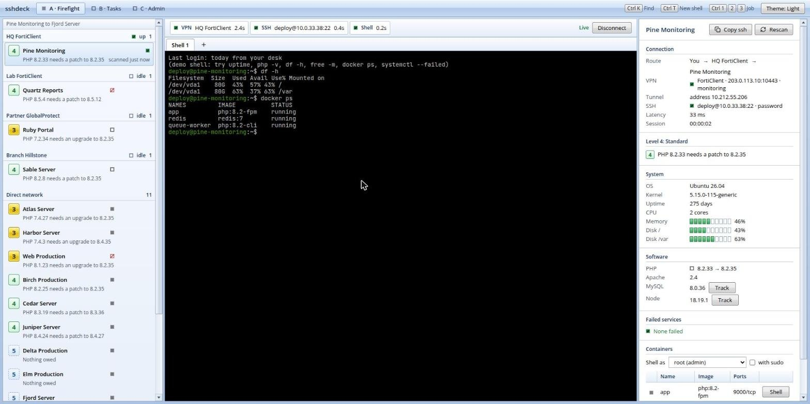

## Features

- SSH logins by password, key file or ssh-agent; shells open in tabs over one shared connection
- VPN profiles for FortiClient (`openfortivpn`) and GlobalProtect (`gpclient` or `openconnect`). Hillstone has no
  Linux client, so you connect it yourself and confirm in the app. It asks before a second VPN goes up.
- Files: browse over SFTP, drag and drop transfers, an editor, search, and a history of every save you can restore
- The same for running Docker containers, plus `docker exec` shells
- Tunnels (port forwards), jump hosts, and import from CSV or `~/.ssh/config`
- Run one command on several servers, copy files to several, saved snippets, and followed logs
- Restart, start or stop a failed service or a container from the analysis
- Observe: live CPU, memory, disk and network for every connected server, a week of history, and alerts when a disk
  fills or a service fails
- A read-only scan of each server, with servers ranked 1 to 5 by what needs doing, and tasks tied to servers
- Reconnects when an SSH link or VPN tunnel drops
- Passwords in the OS keyring, or in an encrypted vault behind a passphrase; an audit log of what was done

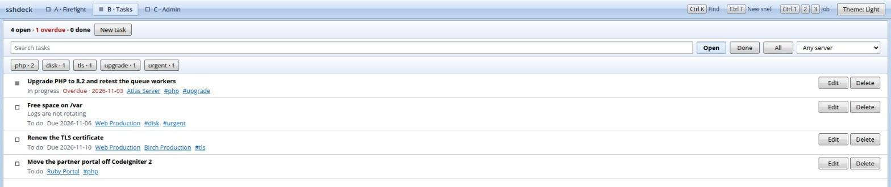

## Install

Needs Linux with GTK 3 and WebKitGTK 4.1 (`libgtk-3-0` and `libwebkit2gtk-4.1-0` on Debian and Ubuntu).

Download the tarball from the [latest release](../../releases/latest), then:

```sh
tar xzf sshdeck-v*-linux-amd64.tar.gz
cd sshdeck-v*-linux-amd64
./install.sh
```

This checks the files against `SHA256SUMS` and installs into `~/.local/bin` for the current user. Admin, System lists
the VPN clients that are missing and installs them. Starting a VPN asks for your password through `pkexec`.

On Windows, unzip `sshdeck-v*-windows-amd64.zip` and run `sshdeck.exe` (it needs the WebView2 runtime, which Windows 10
and 11 already have). For VPNs, Admin, System has an Install button for OpenConnect, which handles both GlobalProtect
and FortiClient. The first VPN you start in a session asks for administrator approval (UAC); after that sshdeck
reconnects without asking again. Hillstone is still connected by hand.

sshdeck checks GitHub for a newer release when it starts and shows an Update button; Admin, System also has a
"Check for updates" button and a switch for the startup check. Updates are signed and verified before they are installed.

## Usage

1. Admin, VPN profiles: add a profile if some servers are behind a VPN.
2. Admin, Servers: add a server with its host, user and password or key, and pick its VPN.
3. Firefight: select the server and press Connect.

Ctrl+K finds a server, Ctrl+T opens a shell tab, Ctrl+1 to Ctrl+5 switch between Firefight, Tasks, Admin, Run and Observe, and
Ctrl+Shift+F searches the terminal.

### Import

Admin, Import reads a CSV ("Save a blank template" shows the columns) or the hosts in `~/.ssh/config`, including
`ProxyJump`. Each row shows as new, update or error before anything is saved, and a blank password keeps the stored
one. Hosts from an ssh config log in with the key or the ssh-agent.

### Files

1. Connect to the server and open the Files tab next to Analysis.
2. Upload with the button or by dragging files in. Select files and press Download to get them.
3. The magnifier searches under the current folder by name, or by text inside files. Click a result to open it.
4. The terminal button opens a shell in the current folder.
5. When the server runs containers, the picker at the top switches the tab to a container's files. As root that goes
   through the host's `/proc`; otherwise it uses `docker exec`. Saved files keep their owner and permissions.

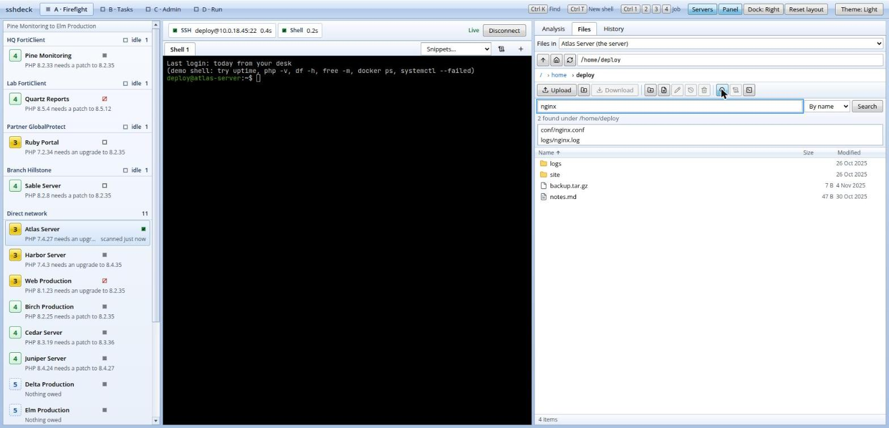

### Editing and history

Double-click a file to edit it in a tab (Ctrl+S saves). If the file changed on the server since you opened it, sshdeck
asks before overwriting. Files over 2 MB or that are not text are download-only.

Every save keeps the text it replaced. The History button lists the versions of a file; click one to see what changed,
and "Restore the older version" puts it back as a new version. The History tab next to Files shows who edited what on
the whole server. A copy is also written to `~/.sshdeck/history` on the server so teammates see each other's edits
(production servers need it turned on first). Old versions can hold passwords, so Admin, History has the settings and
a delete button.

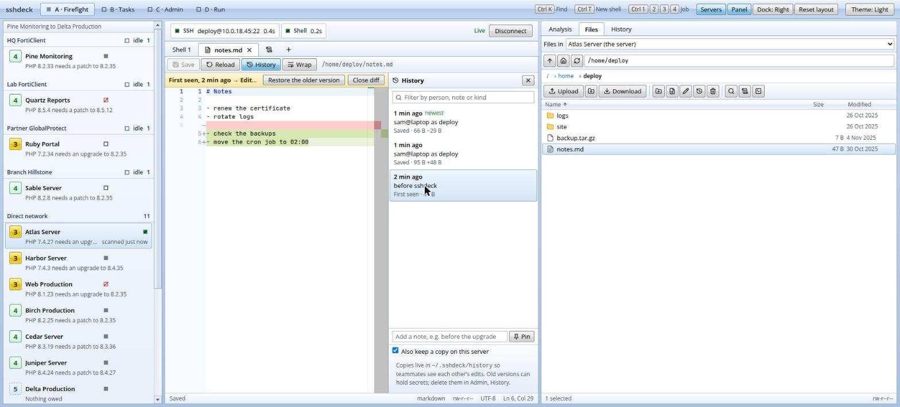

### Tunnels and jump hosts

Add tunnels to a server in Admin, Servers: a name, whether it is local or remote, the address to listen on, and the
target. Once connected, the Analysis tab lists them with Start and Stop. A local tunnel listens on this machine, so
`127.0.0.1:5433` can reach a database that only the server can see. Tick Auto to start one when the server connects.
"Jump through" on a server logs in by way of another server, like `ssh -J`; a server with no VPN of its own uses its
jump host's.

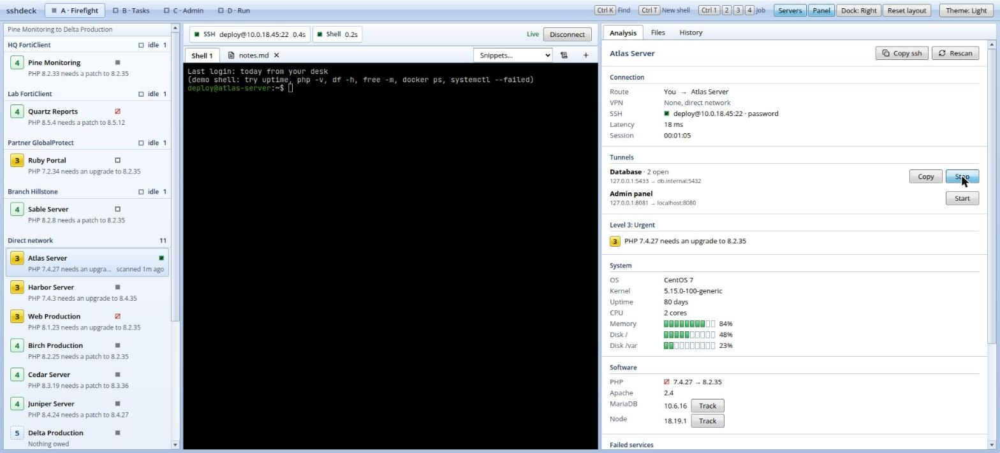

Two VPNs at once often break each other's routes and DNS, so connecting a server on a different VPN while one is up
asks first. Switch disconnects the servers on the old VPN; Connect both leaves them.

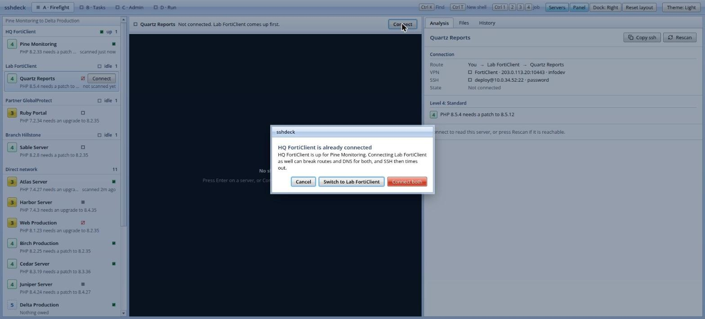

### Run a command on several servers

1. Press Ctrl+4 for the Run view and tick the servers. "Pick connected" ticks the ones that are connected already;
   Connect brings up the rest through the normal flow, so the VPN and production questions still get asked.
2. Type a command, or choose a saved snippet, and press Run. Servers that are not connected are skipped, never
   dialled behind your back, and production servers ask first.
3. Each server answers in its own card with the exit code, time and output. Tick "Only failed" to see the ones that
   went wrong, and Stop ends a run that is still going.

Save commands you use often in Admin, Snippets, or with "Save as snippet" in the Run view. Each terminal also has a
Snippets menu that types a snippet without running it.

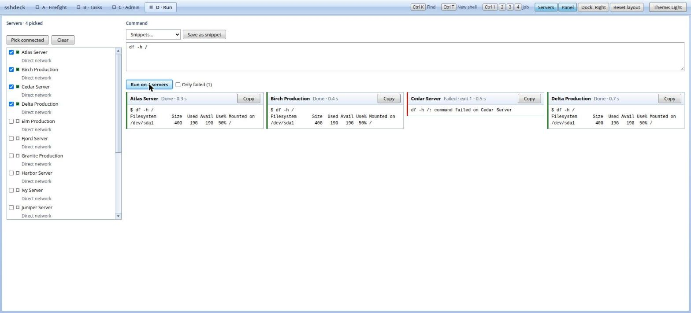

To put the same files on several servers, switch the Run view to "Copy files". Pick the servers, type the folder on
the servers, say what to do when a file is already there (leave it, replace it, or keep both), then press Files… or
Folder…. Each server answers with what it started and what it left alone, and the copies show their progress. As with
a command, servers that are not connected are skipped and production servers ask first.

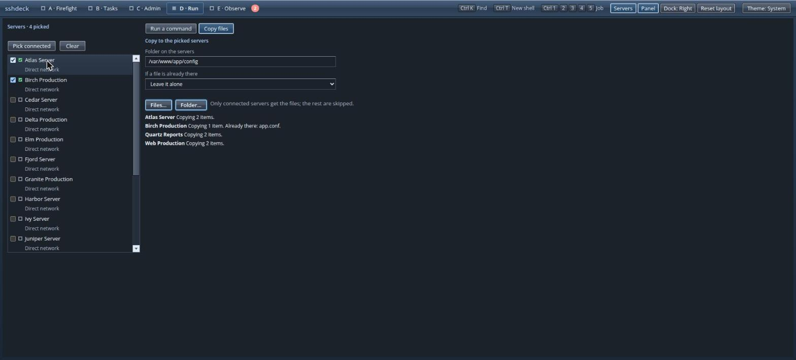

### Services and containers

In the Analysis tab, a failed service has Log, Status and Restart buttons, and each container has Start or Stop and
Restart. Anything on a production server, and every stop, asks first. If the login is not allowed to do it, sshdeck
tries once more with `sudo -n`; when sudo wants a password it says so and you use a terminal instead. sshdeck never
types a password into a server.

### Observe

Ctrl+5 shows every server as a card: CPU, memory, the fullest disk and network traffic, with a short trend. Servers
that are connected come first, sorted by how much they need you; the rest have a Connect button. sshdeck only reads
servers you are already connected to, so nothing is read in the background from the others. Open a card for the
details: charts for CPU, load, memory, network and disk activity over 15 minutes to 7 days, the busiest processes,
failed services and containers with their buttons, and the alerts for that server.

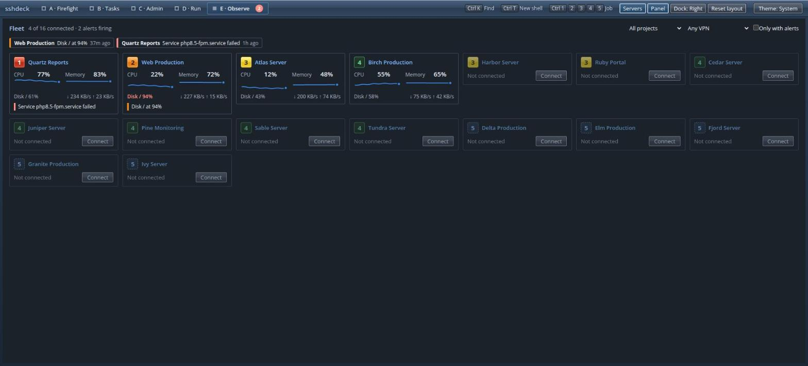

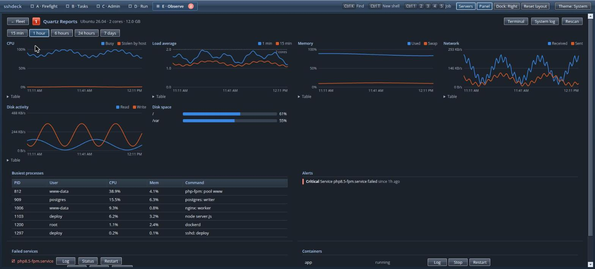

An alert appears when a disk is over 90%, memory or CPU stay over their line for five minutes, the load is more than
twice the number of cores, a service fails, a container restarts or stops, or a connection drops and cannot be
brought back. It shows on the Observe tab, in the audit log, and as a desktop notification. Admin, System has the
intervals and the levels, and a switch to turn it all off. Readings are kept for 7 days, as numbers only, in the data
folder.

### Logs

The scroll button in the terminal bar follows the system journal. The same button in the Files tab follows the
selected file like `tail -f`, and Analysis has a Log button for each failed service and container. A log opens as a
tab. Type in the filter to narrow it (`/error|warning/` is a regular expression), Pause to read without it moving,
and Copy to take what is shown. Errors and warnings are coloured, and it keeps the last 10,000 lines.

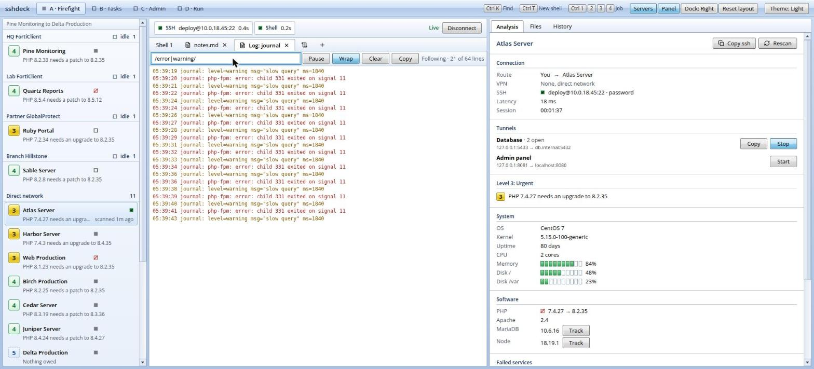

### Layout

Drag the borders between panels to resize them. Ctrl+B hides the server list, Ctrl+. hides the side panel, and "Dock"
moves the side panel next to the server list. "Reset layout" puts everything back.

The passphrase lock is in Admin, Security. There is no recovery if the passphrase is lost.

Data lives in `~/.config/sshdeck/` (on Windows, under `%AppData%\sshdeck`).

## Build from source

Needs Go, Node, the [`wails`](https://wails.io) CLI (`go install github.com/wailsapp/wails/v2/cmd/wails@latest`) and,
on Debian or Ubuntu, `pkg-config libgtk-3-dev libwebkit2gtk-4.1-dev`.

```sh
git clone https://github.com/KushalNaral/sshdeck.git
cd sshdeck
wails build -tags webkit2_41     # binary in build/bin/sshdeck
```

For development use `wails dev -tags webkit2_41`, and run the tests with `go test ./... && (cd frontend && npm test)`.
`./packaging/package.sh v0.9.0` builds the same tarball that the releases carry.

See [docs/ARCHITECTURE.md](docs/ARCHITECTURE.md) for how it works and [DESIGN.md](DESIGN.md) for the look.
