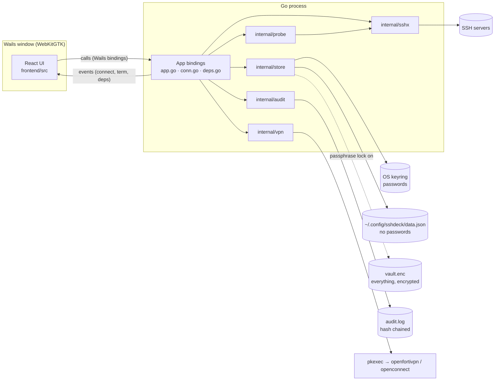
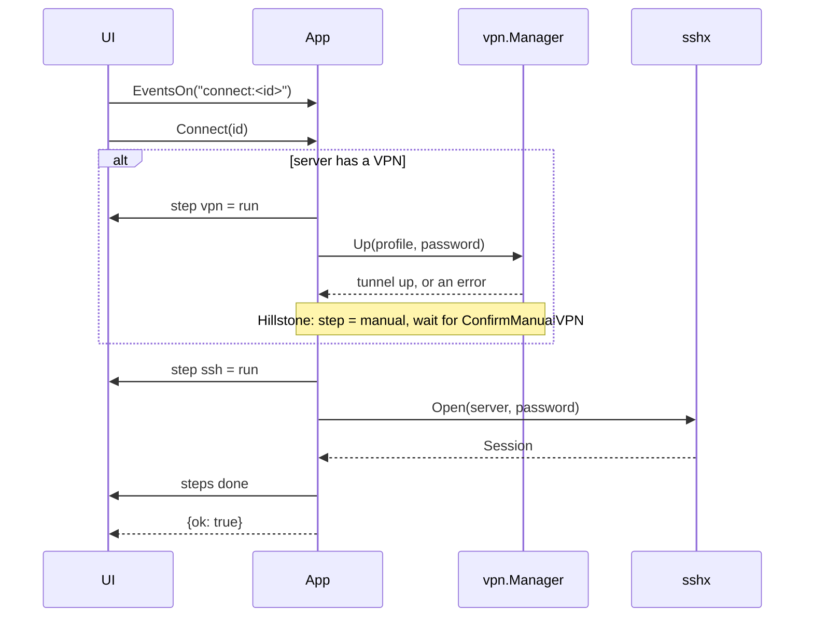

# sshdeck architecture

sshdeck is a desktop app for a small support team. It keeps SSH and VPN credentials safe, brings a VPN up,
opens SSH terminals (including inside Docker containers) and runs read-only analysis of a server. It is a
[Wails v2](https://wails.io) app: a Go backend and a React UI in one native window.

## 1. The shape of it



The UI never sees a password after the form is submitted. Everything that touches a secret, a socket or a
process is in Go. The UI asks, Go acts, and Go pushes progress back as events.

## 2. Packages

| Package | Job | Key types |
|---|---|---|
| `main`, `app.go` | Window setup (CSP-friendly options, single instance), the `App` struct, lifecycle (startup, shutdown, confirm-on-close), CRUD pass-through to the store | `App` |
| `conn.go` | Connect flow, shells and tabs on one shared SSH connection, container shells, analysis entry point | `Connect`, `AttachShell`, `OpenContainerShell`, `Analyze` |
| `lock.go`, `settings.go` | Passphrase lock, idle timeout, lock settings, audit view bindings | `Lock`, `Unlock`, `EnableLock`, `DisableLock`, `ListAudit` |
| `perm.go` | Startup check that the config directory and files are private | `checkConfigDir` |
| `deps.go` | Check and install the programs sshdeck needs (VPN clients) | `CheckDependencies`, `InstallDependencies` |
| `internal/store` | Servers, VPN profiles and tasks; passwords in a `Secrets` backend, or everything inside the encrypted vault when the lock is on | `Store`, `Server`, `VPN`, `Task`, `Secrets`, `Keyring` |
| `internal/vault` | Argon2id key derivation and XChaCha20-Poly1305 sealing of the vault file | `Key`, `NewKey`, `Open` |
| `internal/audit` | Append-only, hash-chained log of what was done | `Log`, `Entry`, `Verify` |
| `internal/sshx` | SSH login (password, key file or ssh-agent) with host-key trust and keepalive; one connection shared by many shells and commands | `Client`, `Dial`, `Session` |
| `internal/vpn` | Start and stop VPN client processes and watch their output | `Manager`, `Starter`, `Proc`, `CertError` |
| `internal/probe` | Run read-only commands and parse them into a report | `Analyze`, `Report`, `Run` |
| `internal/importer` | Read the master `.ods` project list | `ReadODS`, `Projects`, `Sheet.Pairs` |
| `frontend/src` | The UI (see section 8) | `Backend` interface |

Dependencies point one way: `main` → `store`, `sshx`, `vpn`, `probe`. `probe` takes a plain
`func(cmd string) (string, error)`, so it knows nothing about SSH. `vpn` takes a `Starter`, so it knows nothing
about `os/exec`. `App` takes `dial` and `lookPath` functions, a `vpn.Manager` and an `audit` function, so its flows
are tested without a network or a window.

## 3. Data and secrets

```
~/.config/sshdeck/data.json    servers, VPNs, tasks         mode 0600, written atomically (default setup)
~/.config/sshdeck/vault.enc    the same plus passwords      encrypted, replaces data.json while the lock is on
~/.config/sshdeck/settings.json lock timeout, end-on-lock   mode 0600, no secrets
~/.config/sshdeck/audit.log    audit trail                  mode 0600, hash chained
~/.config/sshdeck/known_hosts  SSH host keys (first use)    mode 0600
OS keyring, service "sshdeck"  server/<id>, vpn/<id>, login/<server>/<id>   passwords
$XDG_RUNTIME_DIR/sshdeck-vpn-*.conf  openfortivpn config    0600, deleted when the attempt ends
```

- `data.json` holds no passwords. A test saves a server with a password and asserts the file never contains it.
- Writes go to a temp file in the same directory, are `chmod`ed to 0600 and renamed over the real file.
- A blank password on save means "keep the stored one". Deleting a VPN that servers still use is refused
  (`VPNInUseError`).
- IDs are slugs plus random bytes, or any stable string the caller supplies. Re-saving the same ID replaces it.
- A server tracks `software` (name, version now, target) and has other `logins` (database, cPanel, RDP...). Login
  secrets are stored like passwords, deleted with the login or server, and carried by the vault migration. They leave
  Go only through `CopyLogin`, which writes the clipboard from Go and wipes it after 30 s unless something else was
  copied since. The audit trail records the copy, never the value. `SaveServer` ignores incoming logins: they change
  only through `SaveLogin` and `DeleteLogin`.
- **Import and export** (`importer.go`, `internal/importer/csv.go`): one CSV with a `type` column (vpn, server,
  login). `PickImport` parses the file in Go and returns a preview without passwords; `ApplyImport` saves the picked
  rows, VPNs first, then servers, then logins. Same name means update, and a blank password cell keeps the stored
  secret. Export writes the same format with the password column empty (mode 0600).
- `Server.AutoConnect` ("connect when sshdeck starts"): after unlock `App.tsx` connects those servers once per launch,
  one at a time, production ones last and each behind its confirmation, so admin-password prompts never stack.
- The scan fills `Report.Software` from a table of read-only version commands (`probe.detectors`).
- Go uses `vpnId: ""` for "direct"; the UI uses `null`. The mapping lives in `frontend/src/lib/config.ts`.

## 4. Connect flow

`Connect(serverId)` returns a `ConnectResult`. A failure is data (`problem` + `recovery`), not an exception, so
the UI can show what happened and what to do next.



- Steps are `vpn` (only when the server has one or requires one), `ssh`, `shell`, each `wait → run → done | fail`.
- Cancelling (`Disconnect` while connecting) cancels the connect's context.
- Failures are classified into plain sentences: missing client, no stored password, wrong user or password,
  unreachable host, changed host key, untrusted VPN certificate.
- A VPN shared by several servers stays up until the last of those servers disconnects.

After a VPN has come up, SSH does not start at once: `waitRoute` first checks that the server answers on its SSH port,
every 0.7 s for up to 30 s, and the SSH step says "waiting for the VPN route" while it does. A client reports the tunnel
up a moment before its routes and DNS are in place, and without this the first attempt timed out and only a retry worked
(seen with GlobalProtect and openconnect on Windows). When the time runs out SSH is tried anyway, so its own error is the
one the user sees; cancelling stops the wait and takes the VPN down as usual. The reconnect path does the same after it
restarts a tunnel.

## 5. Terminals

A connected server has **one SSH connection** (`sshx.Dial`) that every tab and the analysis share; each tab is a
separate PTY channel on it. Tab 1 is created by `Connect`; other tabs are created when the UI first attaches to
them. If the link drops (keepalive fails or the server closes it), a watcher (`reconnect.go`) redials by itself:
five attempts at 2, 4, 8, 16 and 30 s, restarting the VPN first when it is down (Hillstone is manual and is skipped).
A VPN tunnel that dies first is noticed too: for a background client (`gpclient`) the manager records the
interface its tunnel added (`tun0`) and `Status` reports Down once it disappears; every 5 s each connection checks
this and ends its SSH link, which starts the same reconnect. If no new interface appears, the client is trusted.
A refused login is never retried, because that can lock the account. Progress goes to the UI as `link:<serverId>`
events (reconnecting, live, lost); ended tabs restart on `live`. The setting `noAutoReconnect` in `settings.json` turns it
off. Without the watcher, the tabs end and the next tab or Reconnect logs
in again on a fresh connection.

- Output: `AttachShell(serverId, tab, cols, rows)` starts a goroutine that forwards the session's output as
  `term:<id>:<tab>:out` events, **base64**-encoded so non-UTF-8 bytes survive. `term:<id>:<tab>:end` fires when the
  remote side closes.
- Input and size: `TermWrite`, `TermResize`. `CloseShell` ends one tab.
- The UI subscribes to events *before* calling `AttachShell`, and output buffers in the session until it does.
- **Container shells:** `OpenContainerShell` opens a tab's session and types
  `exec [sudo] docker exec -it [-u USER] NAME sh -c '…bash || sh'` into it. Container and user names are matched
  against strict patterns first, so nothing shell-special reaches the line. `exec` replaces the login shell, so
  leaving the container ends the tab.

## 6. VPN

`vpn.Manager` runs one client per profile and decides "up" by reading the client's output:

| Kind | Command | Password | "Up" line |
|---|---|---|---|
| FortiClient | `pkexec openfortivpn -c <file>` | in a 0600 config file, deleted when the attempt ends | `Tunnel is up` |
| GlobalProtect | `pkexec openconnect --protocol=gp --user U --passwd-on-stdin host:port` | stdin | `Connected as` |
| Hillstone | none (no Linux client) | n/a | the user confirms in the UI |

- Passwords never appear in a command line (tests enforce this).
- `pkexec` shows the system's own admin-password prompt. Because the client then runs as root, plain signals from
  the app are refused, so `ExecStarter.Stop` falls back to `pkexec kill` on the client's children, and
  `Pdeathsig` makes the launcher exit with the app. This is **not yet confirmed on a real VPN**.
- Errors are built from the client's `ERROR` lines, not its last line (which is usually just "Could not log out").
- After the tunnel is up the manager keeps draining the client's output so the client never blocks on a full pipe.

### Gateway certificates

Many FortiGate gateways present their **factory certificate**. One looks like this:

```
subject: C=US, ST=California, L=Sunnyvale, O=Fortinet, OU=FortiGate, CN=FG100D0000000000, emailAddress=support@fortinet.com
issuer:  C=US, ST=California, L=Sunnyvale, O=Fortinet, OU=Certificate Authority, CN=support, emailAddress=support@fortinet.com
valid:   2016-05-26 to 2038-01-19      CA:FALSE
```

How it comes to exist: Fortinet generates a key pair for each FortiGate at manufacture and signs a certificate for
it with Fortinet's own private certificate authority. The device serial number goes into the CN (`FG100D…` is a
FortiGate 100D). The certificate is then baked into the device and used for the VPN's TLS until an administrator
installs a different one. It is long-lived (until 2038) and unique per device.

Why Linux rejects it: the signing CA is Fortinet's private one, which is not in any system trust store, so the chain
cannot be validated. Nothing is wrong with the connection itself.

What sshdeck does: the VPN profile has a **Gateway certificate** section with a **Fetch from gateway** button
(`vpn.FetchCert`). It connects to the gateway over TLS, reads the certificate without logging in, and shows its subject,
issuer, validity, whether this computer already trusts it, and its SHA-256 fingerprint in the colon-separated form
administrators publish. **Trust this certificate** then fills in both forms of the pin: the certificate digest
(`openfortivpn`'s `trusted-cert`) and the public-key pin (`pin-sha256:…`, openconnect's `--servercert`, which is preferred
when present). Nothing is trusted until the user clicks, and the screen says to compare the fingerprint with one from the
gateway's administrator, since a certificate read over a network someone else controls could be theirs. Failing a connect
still works too: `openfortivpn` prints the certificate's SHA-256 digest (the hash of its DER encoding) when it
rejects it, and sshdeck reports it for the **Trusted certificate** field. With a digest
saved, `openfortivpn` accepts exactly that certificate and nothing else, which is pinning. Because the factory
certificate is unique per device, a pinned digest also catches a different device answering at the same address.
The proper long-term fix is for the gateway's administrator to install a certificate from a public CA, after which
no pinning is needed. Only pin a digest you have reason to trust.

gpclient refuses to start while an earlier background instance is running (a tunnel that died, or one started by hand).
When it says so, `vpn.Up` runs `gpclient disconnect` and tries the connect once more.

### VPNs on Windows

Windows has no `pkexec`, and a normal process cannot read the output of or stop an elevated one. So the first VPN
start in a session launches a second copy of the app, `sshdeck.exe --vpn-helper ADDR TOKEN`, with the UAC prompt
(`internal/vpn/helper_windows.go`). The helper connects back over loopback, proves it knows a one-time token, and then
runs clients on request; the app talks to it through `HelperStarter`, which is just another `Starter`, so the manager,
reconnect and tunnel watching are unchanged. The helper runs nothing but `openconnect`, from Program Files, with the
options `validateOpenconnectArgs` accepts (no `--script`, no file options), so a process that learned the token still
cannot make it run something else. It stops its clients and exits when the app closes the connection. `openconnect`
handles both protocols there (`--protocol=gp` and `--protocol=fortinet`). A certificate is trusted with
`--servercert pin-sha256:...`, which is what openconnect prints when verification fails.

The protocol, the allow-list and the process handling are ordinary Go and are tested on Linux; only the elevated launch
is Windows-only, and the whole path has not been run against a real gateway.

openconnect says "Connected as" in older versions and "Configured as" in current ones once the tunnel exists (the Fortinet
protocol uses the newer wording), so `ready` is a list of phrases; "Connected to HTTPS" is only the TLS connection and is not
one of them. The client runs with `--non-inter`, so an unknown certificate fails at once (and the pin hint becomes the
certificate error shown to the user) instead of waiting for an answer nobody can type. While connecting, each line the
client prints is passed through `vpn.WithProgress` (with the password blanked out) to the VPN step's detail text, so a
slow connect shows what it is doing.

When a VPN step fails, the error is a `vpn.ClientError`: the message as before, plus the command that was run and the
client's last lines (password blanked out). The connect result carries them as `details`, and the connect bar shows them
under "Show what the VPN client said" with a Copy button. `gpclient` has no Windows build (only macOS, Linux and BSD), so
GlobalProtect on Windows goes through openconnect, which cannot do single sign-on or host-integrity checks; a VPN profile
can be marked **manual** ("I connect this VPN myself"), which treats it like Hillstone: sshdeck waits for the official
app and your confirmation, and never starts it.

For GlobalProtect, openconnect reports itself as an old client (5.1.5-8) unless told otherwise, and portals that enforce
a minimum client version refuse that with an HTTP 512 \"Custom error\" on the login. So `--version-string` is set to what
the official clients report (6.3.3-650 on Windows, 6.3.3-619 on Linux, the same values gpclient uses). A profile can also
\"Sign in at: the gateway directly\" (`--usergroup=gateway`), which skips the portal. A 512 in the client's output is
explained in the connect error as a refused login. The helper's allow-list takes both options with validated values.

### Installing openconnect on Windows

Admin, System offers an Install button for openconnect. It asks the elevated helper for one fixed job
(`sshdeck:install-openconnect`, `internal/vpn/install.go`): download the OpenConnect-GUI installer from the maintainers'
site, check it against a SHA-256 compiled into the app, run it silently (`/S`), and confirm that `openconnect.exe` is
where sshdeck looks. The job has no parameters and the helper refuses it with arguments, so the token cannot be used to
install anything else. The download is checked before it is written, then run from a folder under `%ProgramData%` that
ordinary users cannot modify. The installer leaves `openconnect.exe` (its "console" component) out of a silent install,
and decides each component's initial state from `HKLM\Software\Microsoft\Windows\CurrentVersion\Uninstall\OpenConnect-GUI\
Components\<name>\Installed`; so the job sets that value to 1 for `App_Console` first and puts the registry back if the
install fails (`install_windows.go`). The names were read from the installer's own header. To move to a newer installer, download and check it, then change the URL and hash.

### Updates

`internal/update` asks the GitHub releases API for the newest release (stable builds only see stable releases; a
pre-release build also sees newer pre-releases). Installing downloads the archive for this system, then requires that
`SHA256SUMS` carries a valid ed25519 signature (`SHA256SUMS.sig`, made by `cmd/sign` in the release workflow from the
`UPDATE_SIGNING_KEY` secret) and that the archive matches the signed checksum. The public key is compiled in
(`internal/update/key.go`). Only a member named `sshdeck` (`sshdeck.exe`) is taken from the archive and it is written
next to the running program, so the swap is a rename: directly on Linux, and on Windows by renaming the running exe to
`sshdeck.exe.old`, which is deleted at the next start. A release without a signature is never installed by itself. The
check needs the repository to be public, and a development build (`version == "dev"`) never checks. The version is set
with `-ldflags "-X main.version=..."`. Losing the private key means the next release must be installed by hand and the
embedded key replaced; a backup is kept outside the repository.

## 7. SSH details

- **Auth:** password, a private key file (its passphrase, if any, is the stored secret), or the running
  ssh-agent when no key file is set.
- **Host keys:** trust on first use, stored in `known_hosts`. A key that later changes is refused with a message
  that names the file to edit.
- **Timeouts:** 15 s to connect; `ctx` also bounds the handshake and one-shot commands.
- **Analysis:** `Analyze` first runs `true` (so an unreachable server fails once, not eleven times), then
  `probe.Analyze` runs the commands listed in `internal/probe/probe.go`, all over the server's shared connection (or
  one short-lived login when the server is not connected).
  Every command is read-only; a test asserts nothing outside the list is run.

## 8. Frontend

React + TypeScript + Vite, Tailwind v4, xterm.js, lucide-react. The design direction ("Timetable Slide Rack") and
its rules are in `PRODUCT.md` and `.impeccable/surfaces/frontend-src-app-tsx.md`.

```
App.tsx              state: config, sessions, analysis; shortcuts; mode (Firefight / Tasks / Admin); lock state
api.ts               the Backend interface, ConnectError, and the demo mockBackend
wailsBackend.ts      Backend implemented with the Wails bindings and events
backend.ts           picks wailsBackend inside the window, mockBackend in a plain browser
lib/config.ts        ConfigStore: Go store inside Wails, localStorage demo data otherwise
components/          Rack, ConnectBar, Connection, TerminalPane/Term, Analysis, TasksBoard, Palette, Admin,
                     SystemPanel, SecurityPanel, AuditPanel, LockScreen, Confirm
lib/                 config, lock, audit, theme, version, status
```

Because `Backend` is an interface, `npm run dev` runs the whole UI in a normal browser against fake data, which is
how most visual work is done. Inside `wails dev` the same components talk to Go.

Three jobs share one window: **Firefight** (connect and look), **Tasks** (what needs doing, with tags, servers and
due dates), **Admin** (servers, VPN profiles, System, Security, Audit).

## 9. Testing

| Area | How |
|---|---|
| `sshx` | An in-process `x/crypto/ssh` server: exec output and exit status, wrong password, key and agent login, host-key change, shell echo, resize, close, one shared connection for many shells, keepalive |
| `vault`, `audit` | Round trips, wrong passphrase, tampering, throttling; hash chain edits, rotation |
| `vpn` | A fake `Starter` and fake processes; one test runs real `sh` processes for `ExecStarter` |
| `probe` | Golden command outputs for Ubuntu 22.04 with Docker and CentOS 7 without |
| `store` | Temp directory plus an in-memory `Secrets` |
| `App` | Fakes for `dial`, `lookPath`, the VPN manager, audit and events; covers steps, Hillstone, shared VPN, cancel, lock and idle, audit, shutdown, container commands, dependencies |
| `importer` | Parsing helpers |
| Frontend | `vitest` for pure logic (`lib/version.ts`); the UI is checked by eye in the browser |

Run everything with `go test -race -tags webkit2_41 ./...`.

Not covered by tests: a real VPN, a real SSH server on another network, and the polkit prompt.

## 10. Security

**Data at rest.** Two modes.
- *Default:* metadata in `data.json` (0600), passwords in the OS keyring.
- *Passphrase lock (Admin, Security):* everything moves into `vault.enc`: the server list, VPN profiles, tasks and the
  passwords. Argon2id turns the passphrase into a key, XChaCha20-Poly1305 encrypts and authenticates the file, and the
  header (format, cost settings, salt) is authenticated too. Turning it on migrates the keyring entries into the vault,
  reopens the new file to check it, and only then deletes `data.json` and the keyring entries. There is no recovery
  from a forgotten passphrase. After three wrong passphrases in a row, further attempts wait (0.5 s doubling, capped).

**Locking.** While locked the store holds nothing in memory and every bound method refuses (`ErrLocked`), including
typing into a shell. The idle timer lives in Go, not in the page. Open sessions keep running while locked unless
"end sessions when locking" is on; the page stays mounted but inert behind the lock screen, because unmounting a
terminal ends its shell.

**Audit.** `audit.log` records connects, VPN up/down, shell and container exec, config and lock events. Never
passwords, keystrokes or command output. Each line carries the hash of the line before it; Admin, Audit shows
whether the chain is intact. Limits: editing only the very last line cannot be detected, and the log is plaintext,
so it shows server names even when the vault is locked.

**Production servers.** A server flagged production gets a marker, and the UI asks before connecting and before a
root container shell. The confirmation is recorded (`production.confirm`). This is a guard against mistakes, not an
access control: the page could be driven without it.

**The window.** Production builds carry a Content-Security-Policy (nothing loads from outside the app, no inline
script), no browser context menu, no devtools, and a single-instance lock. `SSHDECK_NO_CSP=1` omits the CSP when
building, in case a packaged window comes up blank.

**Root.** VPN clients run through `pkexec`, so the system asks for the admin password and sshdeck never sees it.
Each client is resolved to an absolute path and refused unless the file and every directory above it are owned by
root and not writable by others. Host, gateway, user and VPN password values that could inject options or config
lines (leading `-`, line breaks, control characters) are refused when saved and again before a client starts. Config
files that hold a password live on the per-user tmpfs, 0600, and a startup sweep removes any a killed run left behind.

**Files.** At startup the config directory is made 0700 and sshdeck's files 0600; a symlink in place of one of them,
or a file owned by another user, stops the app with a clear message.

**Network.** Host keys are trusted on first use, then pinned. VPN gateway certificates are pinned by digest only when
you add one.

**Releases.** `packaging/package.sh` runs the dependency audit (`govulncheck`, `npm audit`), builds without devtools,
and writes `SHA256SUMS` (and a GPG signature with `SIGN_KEY`). `install.sh` verifies the checksums first.

**Not covered.** Anything running as you can read the process's memory while it is unlocked. The vault protects the
data on disk and from a locked screen, not from malware in your session. A password released to the app lives in
memory while in use.

## 11. Known gaps

- VPN stop under `pkexec` and the `openfortivpn` config-file flow are unconfirmed on a real gateway beyond what is
  reported above.
- `govulncheck` reports one advisory in `golang.org/x/crypto` v0.58.0 that sshdeck does not call; the fix exists only
  on an untagged commit, so upgrade when a release carries it.
- Organisation mode (central inventory, OIDC, per-user access) is designed in [ORG-MODE.md](ORG-MODE.md), not built.
