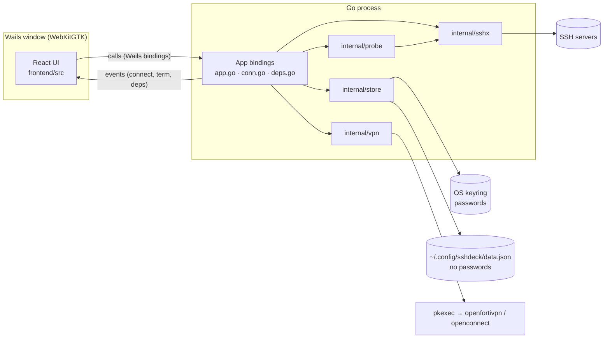
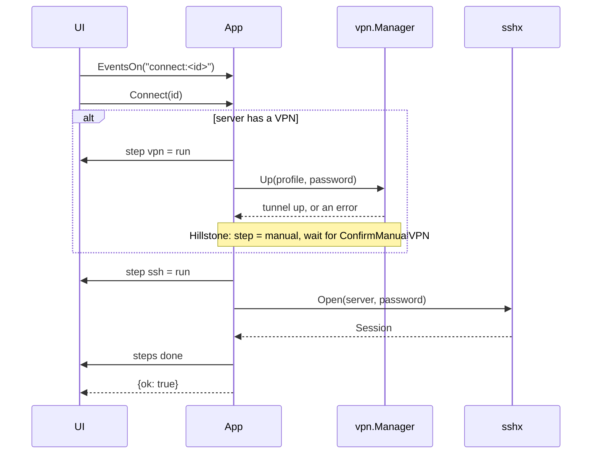

# sshdeck architecture

sshdeck is a desktop app for a small support team. It keeps SSH and VPN credentials safe, brings a VPN up,
opens SSH terminals (including inside Docker containers) and runs read-only analysis of a server. It is a
[Wails v2](https://wails.io) app: a Go backend and a React UI in one native window.

## 1. The shape of it



The UI never sees a password after the form is submitted. Everything that touches a secret, a socket or a
process is in Go. The UI asks, Go acts, and Go pushes progress back as events.

## 2. Packages

| Package | Job | Key types |
|---|---|---|
| `main`, `app.go` | Window setup, the `App` struct, lifecycle (startup, shutdown, confirm-on-close), CRUD pass-through to the store | `App` |
| `conn.go` | Connect flow, shells and tabs, container shells, analysis entry point | `Connect`, `AttachShell`, `OpenContainerShell`, `Analyze` |
| `deps.go` | Check and install the programs sshdeck needs (VPN clients) | `CheckDependencies`, `InstallDependencies` |
| `internal/store` | Server and VPN metadata in JSON; passwords in a `Secrets` backend | `Store`, `Server`, `VPN`, `Secrets`, `Keyring` |
| `internal/sshx` | SSH login with host-key trust, an interactive PTY shell, one-shot commands | `Session`, `Open`, `Run` |
| `internal/vpn` | Start and stop VPN client processes and watch their output | `Manager`, `Starter`, `Proc`, `CertError` |
| `internal/probe` | Run read-only commands and parse them into a report | `Analyze`, `Report`, `Run` |
| `internal/importer` | Read the master `.ods` project list | `ReadODS`, `Projects`, `Sheet.Pairs` |
| `frontend/src` | The UI (see section 8) | `Backend` interface |

Dependencies point one way: `main` → `store`, `sshx`, `vpn`, `probe`. `probe` takes a plain
`func(cmd string) (string, error)`, so it knows nothing about SSH. `vpn` takes a `Starter`, so it knows nothing
about `os/exec`. `App` takes `open` and `lookPath` functions and a `vpn.Manager`, so its flows are tested
without a network or a window.

## 3. Data and secrets

```
~/.config/sshdeck/data.json    servers + VPN profiles       mode 0600, written atomically
~/.config/sshdeck/known_hosts  SSH host keys (first use)    mode 0600
OS keyring, service "sshdeck"  server/<id>, vpn/<id>        passwords
$XDG_RUNTIME_DIR/sshdeck-vpn-*.conf  openfortivpn config    0600, deleted when the attempt ends
```

- `data.json` holds no passwords. A test saves a server with a password and asserts the file never contains it.
- Writes go to a temp file in the same directory, are `chmod`ed to 0600 and renamed over the real file.
- A blank password on save means "keep the stored one". Deleting a VPN that servers still use is refused
  (`VPNInUseError`).
- IDs are slugs plus random bytes, or any stable string the caller supplies. Re-saving the same ID replaces it.
- Go uses `vpnId: ""` for "direct"; the UI uses `null`. The mapping lives in `frontend/src/lib/config.ts`.

## 4. Connect flow

`Connect(serverId)` returns a `ConnectResult`. A failure is data (`problem` + `recovery`), not an exception, so
the UI can show what happened and what to do next.



- Steps are `vpn` (only when the server has one or requires one), `ssh`, `shell`, each `wait → run → done | fail`.
- Cancelling (`Disconnect` while connecting) cancels the connect's context.
- Failures are classified into plain sentences: missing client, no stored password, wrong user or password,
  unreachable host, changed host key, untrusted VPN certificate.
- A VPN shared by several servers stays up until the last of those servers disconnects.

## 5. Terminals

Each tab is its own SSH session (`sshx.Open`). Tab 1 is created by `Connect`; other tabs are created when the
UI first attaches to them.

- Output: `AttachShell(serverId, tab, cols, rows)` starts a goroutine that forwards the session's output as
  `term:<id>:<tab>:out` events, **base64**-encoded so non-UTF-8 bytes survive. `term:<id>:<tab>:end` fires when the
  remote side closes.
- Input and size: `TermWrite`, `TermResize`. `CloseShell` ends one tab.
- The UI subscribes to events *before* calling `AttachShell`, and output buffers in the session until it does.
- **Container shells:** `OpenContainerShell` opens a tab's session and types
  `exec [sudo] docker exec -it [-u USER] NAME sh -c '…bash || sh'` into it. Container and user names are matched
  against strict patterns first, so nothing shell-special reaches the line. `exec` replaces the login shell, so
  leaving the container ends the tab.

## 6. VPN

`vpn.Manager` runs one client per profile and decides "up" by reading the client's output:

| Kind | Command | Password | "Up" line |
|---|---|---|---|
| FortiClient | `pkexec openfortivpn -c <file>` | in a 0600 config file, deleted when the attempt ends | `Tunnel is up` |
| GlobalProtect | `pkexec openconnect --protocol=gp --user U --passwd-on-stdin host:port` | stdin | `Connected as` |
| Hillstone | none (no Linux client) | n/a | the user confirms in the UI |

- Passwords never appear in a command line (tests enforce this).
- `pkexec` shows the system's own admin-password prompt. Because the client then runs as root, plain signals from
  the app are refused, so `ExecStarter.Stop` falls back to `pkexec kill` on the client's children, and
  `Pdeathsig` makes the launcher exit with the app. This is **not yet confirmed on a real VPN**.
- Errors are built from the client's `ERROR` lines, not its last line (which is usually just "Could not log out").
- After the tunnel is up the manager keeps draining the client's output so the client never blocks on a full pipe.

### Gateway certificates

Many FortiGate gateways present their **factory certificate**. The one on the SAVE gateway looks like this:

```
subject: C=US, ST=California, L=Sunnyvale, O=Fortinet, OU=FortiGate, CN=FG100D3G16813519, emailAddress=support@fortinet.com
issuer:  C=US, ST=California, L=Sunnyvale, O=Fortinet, OU=Certificate Authority, CN=support, emailAddress=support@fortinet.com
valid:   2016-05-26 to 2038-01-19      CA:FALSE
```

How it comes to exist: Fortinet generates a key pair for each FortiGate at manufacture and signs a certificate for
it with Fortinet's own private certificate authority. The device serial number goes into the CN (`FG100D…` is a
FortiGate 100D). The certificate is then baked into the device and used for the VPN's TLS until an administrator
installs a different one. It is long-lived (until 2038) and unique per device.

Why Linux rejects it: the signing CA is Fortinet's private one, which is not in any system trust store, so the chain
cannot be validated. Nothing is wrong with the connection itself.

What sshdeck does: `openfortivpn` prints the certificate's SHA-256 digest (the hash of its DER encoding) when it
rejects it. sshdeck reports the digest and offers a **Trusted certificate** field on the VPN profile. With a digest
saved, `openfortivpn` accepts exactly that certificate and nothing else, which is pinning. Because the factory
certificate is unique per device, a pinned digest also catches a different device answering at the same address.
The proper long-term fix is for the gateway's administrator to install a certificate from a public CA, after which
no pinning is needed. Only pin a digest you have reason to trust.

## 7. SSH details

- **Auth:** password only. Servers set to key login return a clear "not supported yet" error.
- **Host keys:** trust on first use, stored in `known_hosts`. A key that later changes is refused with a message
  that names the file to edit.
- **Timeouts:** 15 s to connect; `ctx` also bounds the handshake and one-shot commands.
- **Analysis:** `Analyze` first runs `true` (so an unreachable server fails once, not eleven times), then
  `probe.Analyze` runs the commands listed in `internal/probe/probe.go`. Each command opens its own SSH login.
  Every command is read-only; a test asserts nothing outside the list is run.

## 8. Frontend

React + TypeScript + Vite, Tailwind v4, xterm.js, lucide-react. The design direction ("Timetable Slide Rack") and
its rules are in `PRODUCT.md` and `.impeccable/surfaces/frontend-src-app-tsx.md`.

```
App.tsx              state: config, sessions, analysis; shortcuts; mode (Firefight / Patch / Admin)
api.ts               the Backend interface, ConnectError, and the demo mockBackend
wailsBackend.ts      Backend implemented with the Wails bindings and events
backend.ts           picks wailsBackend inside the window, mockBackend in a plain browser
lib/config.ts        ConfigStore: Go store inside Wails, localStorage demo data otherwise
components/          Rack, ConnectBar, Connection, TerminalPane/Term, Analysis, PatchBoard, Palette, Admin, SystemPanel
```

Because `Backend` is an interface, `npm run dev` runs the whole UI in a normal browser against fake data, which is
how most visual work is done. Inside `wails dev` the same components talk to Go.

Three jobs share one window: **Firefight** (connect and look), **Patch** (the fleet's PHP patch journey), **Admin**
(servers, VPN profiles, System).

## 9. Testing

| Area | How |
|---|---|
| `sshx` | An in-process `x/crypto/ssh` server: exec output and exit status, wrong password, host-key change, shell echo, resize, close |
| `vpn` | A fake `Starter` and fake processes; one test runs real `sh` processes for `ExecStarter` |
| `probe` | Golden command outputs for Ubuntu 22.04 with Docker and CentOS 7 without |
| `store` | Temp directory plus an in-memory `Secrets` |
| `App` | Fakes for `open`, `lookPath`, the VPN manager and events; covers steps, Hillstone, shared VPN, shutdown, container commands, dependencies |
| `importer` | Parsing helpers |
| Frontend | `vitest` for pure logic (`lib/php.ts`); the UI is checked by eye in the browser |

Run everything with `go test -race -tags webkit2_41 ./...`.

Not covered by tests: a real VPN, a real SSH server on another network, and the polkit prompt.

## 10. Security notes

- Passwords: OS keyring only. Not in `data.json`, not in logs, not in command lines.
- The one place a password is briefly on disk is the `openfortivpn` config file: mode 0600 on the per-user tmpfs,
  removed as soon as the attempt ends.
- Installing programs and starting VPNs go through `pkexec`, so the system prompts for the admin password; sshdeck
  never sees it. Only names from a fixed list can be installed.
- Host keys are pinned after first use. VPN gateway certificates are pinned by digest, only when you add one.
- A seed/import of the master `.ods` puts plaintext passwords through memory once and into the keyring; delete the
  spreadsheet afterwards.

## 11. Known gaps

- Key-based SSH login.
- A terminal tab opens a new SSH login, so servers that cap sessions per user may refuse extra tabs.
- Analysis opens one login per command; a shared connection would be faster.
- VPN stop under `pkexec` and the `openfortivpn` config-file flow are unconfirmed on a real gateway beyond what is
  reported above.
- The importer UI with a review screen is not built; the importer package reads the spreadsheet but seeding is done
  by a one-off command that is kept out of the repository because it names real clients.
- Reconnect and keepalive, per-server extra credentials (database, Jenkins, cPanel, RDP), patch-journey history.
